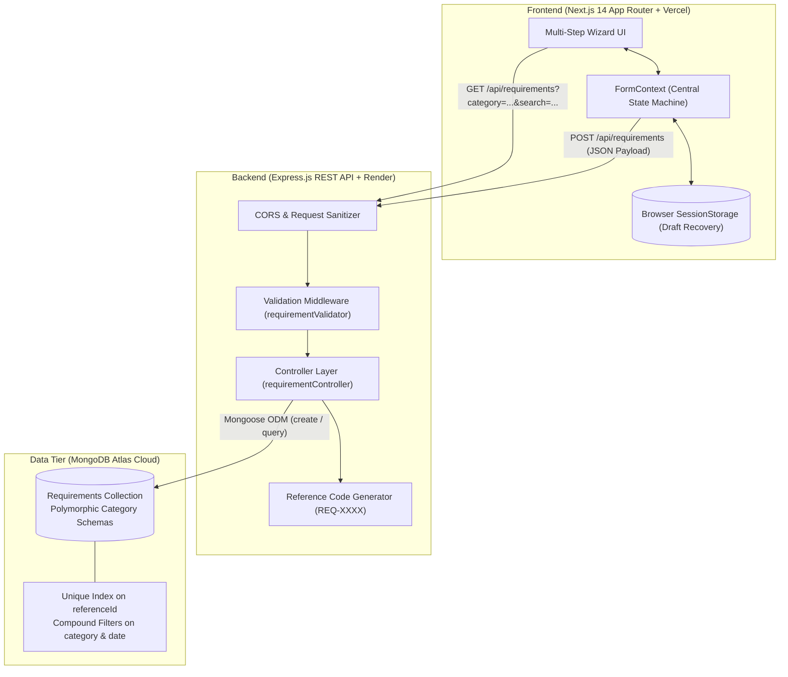
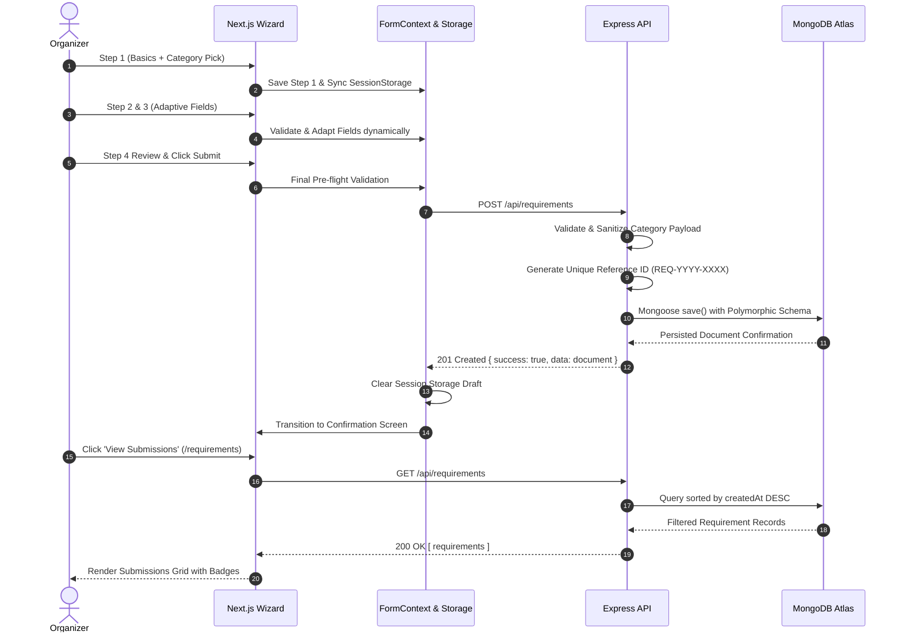

# EventFlow — Requirement Posting Flow

A full-stack, adaptive event requirement posting application built with **Next.js 14 (Frontend)** and **Node.js + Express + MongoDB Atlas (Backend)** for hiring **Event Planners**, **Performers**, and **Crew Members**.

---

## 🌐 Live Deployments & Repository

* **Live Frontend Application (Vercel)**: [https://assignment-umber-omega.vercel.app/](https://assignment-umber-omega.vercel.app/)
* **Submissions Dashboard**: [https://assignment-umber-omega.vercel.app/requirements](https://assignment-umber-omega.vercel.app/requirements)
* **Live Backend API (Render)**: [https://eventflow-backend-bsul.onrender.com](https://eventflow-backend-bsul.onrender.com)
* **Backend Health Check**: [https://eventflow-backend-bsul.onrender.com/api/health](https://eventflow-backend-bsul.onrender.com/api/health)
* **GitHub Repository**: [https://github.com/codewisp-ai/Assignment](https://github.com/codewisp-ai/Assignment)

---

## 🏗️ Architecture Overview

The system follows a decoupled, client-server architecture designed for reliability, strict type safety, and real-time state adaptation.



---

### Sequence Flow: End-to-End Submission



---

## 💡 Key Architectural Decisions & Rationale

| Decision | Rationale & Trade-offs | Alternative Considered |
| :--- | :--- | :--- |
| **Polymorphic Schema with Discriminator** | Storing `basics` alongside category-specific subdocuments (`plannerDetails`, `performerDetails`, `crewDetails`) in a single collection simplifies unified listing, searching, and dashboard reporting while strictly validating category boundaries. | **Three Separate Collections**: Rejected because listing and cross-filtering requirements on a single dashboard would require multiple expensive `$unionWith` aggregation pipelines. |
| **Decoupled Frontend & Backend** | Hosting the frontend on Vercel and backend on Render allows independent horizontal scaling, independent rollback cycles, and zero serverless timeout issues with MongoDB connection pools. | **Next.js Full-Stack (Server Actions)**: The assignment specifically requested a standalone Node.js + Express backend service. |
| **Centralized FormContext with Session Persistence** | Using a dedicated React Context provider decouples wizard UI steps from state logic and automatically syncs progress to `sessionStorage`. Users never lose their draft if they accidentally refresh or navigate back. | **Prop Drilling / Local Component State**: Fragile across 4 wizard steps and causes immediate data loss on page reload. |
| **Human-Readable Reference IDs** | Generating tracking codes like `REQ-MVMHT2R4-9988` alongside native MongoDB `_id` provides readable, memorable order references for organizers and talent. | **Exposing raw ObjectId only**: Harder for non-technical users to reference or copy. |
| **Native ES Modules in Node.js** | Used `"type": "module"` with Node.js native watch mode (`node --watch`). Zero build steps or Babel/TypeScript compile overhead needed on the backend. | **Babel / ts-node / Webpack Backend**: Adds unnecessary transpiler complexity and slower startup times. |

---

## 🎯 Assumptions Made

1. **Public Posting Flow**: Per the assignment scope, requirement posting is accessible without mandatory login barriers. Tracking and reference retrieval are handled through the generated `referenceId`.
2. **Category Mutually Exclusive**: An event requirement is strictly tagged to one professional role at a time (`planner`, `performer`, or `crew`). If an organizer needs both a planner and a band, they post separate requirements for clean contractor allocation.
3. **Budget Representation**: Currency values are assumed in standard base units (e.g., USD/INR) with positive values.
4. **Time Zone Alignment**: Event start and end dates are transmitted in ISO 8601 UTC format to ensure date integrity across client and server time zones.

---

## 🛡️ Edge Cases Handled

### 1. Date Logic & Inversion Prevention
* **End Date Precedence**: When "Multi-Day Range" is active, the UI and the backend reject any `endDate` that precedes `startDate`.
* **Optional Date Sanitization**: In single-day mode, `endDate` is sent as `undefined` rather than empty string `""`, preventing Mongoose Date cast errors (`Cast to date failed for value ""`).

### 2. Category Isolation & Cross-Contamination Protection
* If a payload arrives tagged as `category: 'performer'`, any legacy or malicious `plannerDetails` or `crewDetails` are stripped out at the controller level before database persistence.

### 3. Number Input UX & Clearing Behavior
* Number inputs (guest counts, duration minutes, budget ranges, crew headcounts) use `value={val === 0 ? '' : val}` with immediate state synchronization.
* Users can completely backspace inputs to empty without a stubborn `0` trapping their keystrokes.
* Field-level validation errors clear instantly upon keystroke/correction rather than lingering until the next step click.

### 4. Dynamic Crew Role Allocator
* Organizers can dynamically add and remove crew roles.
* Form validation verifies that at least one crew role is present and that every added role has both a non-empty title and headcount $\ge 1$.
* Prevented accidental removal of the final remaining role item to maintain valid form structure.

### 5. CORS Preflight & Network Resilience
* Backend employs permissive CORS with support for browser `OPTIONS` preflights across localhost, 127.0.0.1, and remote production origins (Vercel).
* Graceful network error handling: If the backend service is starting up, the frontend presents a clear, actionable error banner rather than a generic JavaScript `Failed to fetch`.

### 6. Sticky Step Navigation Guard
* When users click "Post Requirement" or the brand logo in the header while in review or after posting, the wizard resets to **Step 1** instead of leaving them stranded on Step 4.

---

## ⚠️ Known Limitations & Future Roadmap

1. **Authentication & Authorization**:
   * *Current State*: Open posting flow per assignment requirements.
   * *Improvement*: Integrate **Clerk** or **NextAuth.js** to associate requirements with organizer accounts, enabling private draft saving and requirement cancellation.
2. **File Attachments (Stage Plots & Technical Riders)**:
   * *Current State*: Rider specifications are captured as structured text fields.
   * *Improvement*: Add AWS S3 or Cloudinary pre-signed URL uploads for PDF stage plots, audio channel lists, and venue schematics.
3. **Real-time Talent Notification**:
   * *Current State*: Submissions are stored and queried on-demand.
   * *Improvement*: Integrate WebSockets (Socket.io) or Webhooks to instantly alert registered performers and crew when a matching requirement is posted in their city.
4. **Pagination for Submissions Feed**:
   * *Current State*: Client-side search and category filtering with sorted limit.
   * *Improvement*: Add cursor-based backend pagination (`/api/requirements?page=1&limit=10`) as submission volume scales.

---

## 📁 Repository Structure

```
├── backend/
│   ├── src/
│   │   ├── config/
│   │   │   └── db.js                    # MongoDB connection with retry resilience
│   │   ├── controllers/
│   │   │   └── requirementController.js # CRUD handlers & Reference ID generator
│   │   ├── models/
│   │   │   └── Requirement.js           # Polymorphic Mongoose schema
│   │   ├── routes/
│   │   │   └── requirementRoutes.js     # Express REST router
│   │   ├── validators/
│   │   │   └── requirementValidator.js  # Field validation & sanitization layer
│   │   └── server.js                    # Express app, CORS, and 0.0.0.0 listener
│   ├── .env.example
│   └── package.json
├── frontend/
│   ├── src/
│   │   ├── app/
│   │   │   ├── globals.css              # Tailwind CSS styles
│   │   │   ├── layout.tsx               # Root layout & FormProvider context wrapper
│   │   │   ├── page.tsx                 # Wizard coordinator & navigation controls
│   │   │   └── requirements/page.tsx    # Live submissions feed, search & filters
│   │   ├── components/
│   │   │   ├── ConfirmationScreen.tsx   # Post-submission confirmation card & copy ID
│   │   │   ├── Navbar.tsx               # Header navigation & wizard step reset
│   │   │   ├── StepProgressBar.tsx      # Dynamic wizard progress indicator
│   │   │   └── steps/
│   │   │       ├── Step1Basics.tsx      # Event basics & interactive category picker
│   │   │       ├── Step2Details.tsx     # Adaptive Step 2 (Scope, Set Length, Crew Roles)
│   │   │       ├── Step3Details.tsx     # Adaptive Step 3 (Services, PA Rider, Safety Badges)
│   │   │       └── Step4Review.tsx      # Review summary card with inline edit triggers
│   │   ├── context/
│   │   │   └── FormContext.tsx          # Central state machine & sessionStorage sync
│   │   └── types/
│   │       └── index.ts                 # TypeScript interfaces and domain types
│   ├── .env.example
│   └── package.json
└── README.md
```

---

## 📡 API Reference

### 1. `POST /api/requirements`
Creates a new event requirement with category-specific validation.

* **Headers**: `Content-Type: application/json`
* **Request Body (Example: Performer)**:
```json
{
  "basics": {
    "eventName": "Summer Beats Music Fest",
    "eventType": "concert",
    "isDateRange": false,
    "startDate": "2026-11-20",
    "location": "Mumbai, India",
    "venue": "Bandra Amphitheatre"
  },
  "category": "performer",
  "performerDetails": {
    "performerType": "live_band",
    "durationMinutes": 90,
    "genreOrStyle": "Indie Alternative Rock",
    "soundSetupProvided": true,
    "micCount": 4,
    "soundcheckTiming": "3:00 PM (2 hours prior to gates)",
    "specialRequests": "Requires 2 DI boxes and dedicated monitor wedge mix."
  }
}
```
* **Response `201 Created`**:
```json
{
  "success": true,
  "message": "Requirement posted successfully",
  "data": {
    "_id": "6adcc03cc32cb66ca2429955",
    "referenceId": "REQ-MVMHT2R4-9988",
    "basics": { ... },
    "category": "performer",
    "performerDetails": { ... },
    "status": "submitted",
    "createdAt": "2026-10-24T14:27:08.555Z"
  }
}
```

### 2. `GET /api/requirements`
Retrieves all requirements. Supports filtering and search query parameters.
* **Query Parameters**:
  * `category`: `planner` | `performer` | `crew`
  * `search`: string (case-insensitive substring match on `eventName`)
* **Response `200 OK`**:
```json
{
  "success": true,
  "count": 2,
  "data": [ ... ]
}
```

### 3. `GET /api/requirements/:id`
Retrieves a single requirement by either its MongoDB `_id` or readable `referenceId`.

### 4. `GET /api/health`
Health check endpoint returning service status and UTC timestamp.

---

## ⚡ Local Development Setup

### Prerequisites
* Node.js $\ge$ 18 (Node 20 or 24 recommended)
* MongoDB database (local instance or MongoDB Atlas connection string)

### 1. Backend Setup
```bash
cd backend
npm install
cp .env.example .env
# Fill in your MONGODB_URI in .env
npm run dev
```
* Backend runs on: `http://localhost:5000`
* Health check: `http://localhost:5000/api/health`

### 2. Frontend Setup
```bash
cd frontend
npm install
cp .env.example .env.local
# Set NEXT_PUBLIC_API_URL=http://localhost:5000/api in .env.local
npm run dev
```
* Frontend runs on: `http://localhost:3000`
